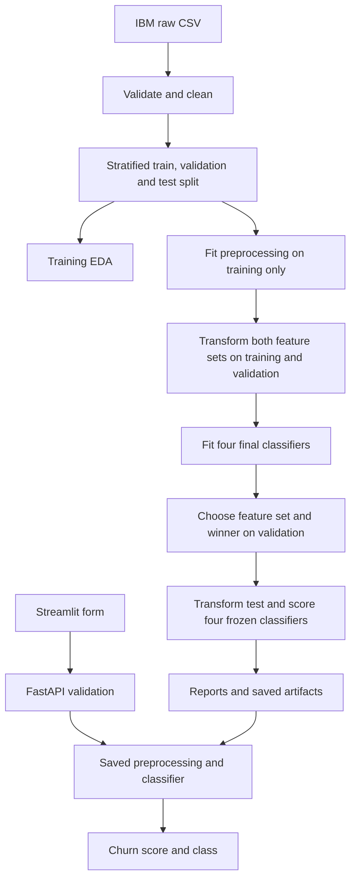

# Architecture

Training learns the median for missing numbers, the most frequent value for missing categories, scale parameters for the numbers and categories for one-hot encoding. An unseen category transforms to zeros in its one-hot group. Each classifier uses the same transformed training matrix. Each feature set gets its own training-fitted preprocessor and the same tuning budget. Validation keeps its natural class ratio and is used to choose model settings, the feature set, and the deployment model. Test scoring happens after that decision.

The API loads a trusted joblib preprocessor and one of four model files from the fixed model directory. Client input is a JSON object with a `customer` field and optional `model_id`. The dashboard reads the model catalog and sends a prediction request to FastAPI. The API returns the model ID, a 0 or 1 class and a score between zero and one.

The app starts before training. Health reports whether the selected files exist, and prediction and metrics give a 503 while their artifacts are unavailable.
